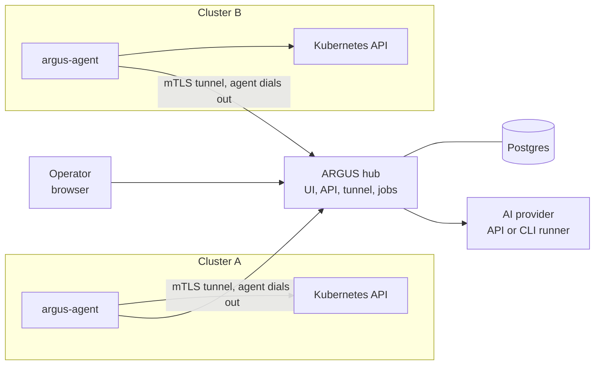
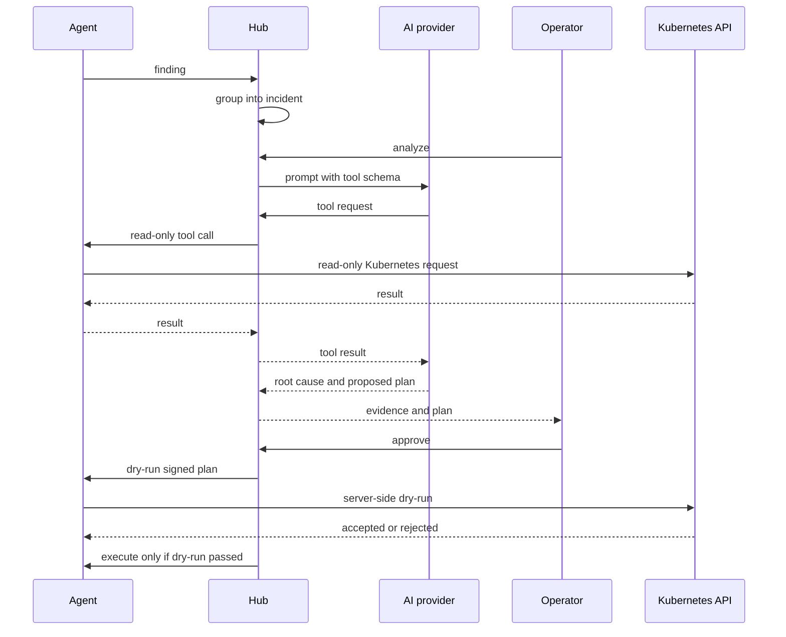

# ARGUS Architecture

This is the plain-language map of ARGUS: what runs, where it runs, how clusters connect, and what
safety boundaries are in place.

For installation steps, use [INSTALL.md](INSTALL.md). For
operations and troubleshooting, use [RUNBOOK.md](../RUNBOOK.md).

## The Short Version

ARGUS is a hub-and-agent system for Kubernetes operations.

- You run one **hub** with a web UI, API, database connection, and agent tunnel listener.
- Each watched Kubernetes cluster runs one **agent**.
- Agents dial out to the hub. The hub never needs a kubeconfig and never opens an inbound connection
  into your clusters.
- The hub stores state in **Postgres**.
- Analysis uses either an external API provider or the optional **CLI runner** for Claude Code or
  Codex.
- By default, agents are read-only. Remediation is an explicit per-cluster opt-in.

## Components

| Component | Where it runs | What it does |
|---|---|---|
| `argus-hub` | Your hub environment | Serves the UI/API, accepts agent tunnels, runs migrations and background jobs |
| Postgres | Beside or outside the hub | Stores users, settings, clusters, findings, incidents, analyses, plans, and audit events |
| `argus-agent` | Each watched Kubernetes cluster | Detects symptoms, answers read-only questions, and optionally executes approved fixes |
| `argus-cli-runner` | Optional, beside the hub | Runs Claude Code or Codex as an isolated analysis backend |

There is no Redis, NATS, object store, or separate frontend service in the current runtime. The web UI
is embedded into the hub image.

## How A Cluster Connects

ARGUS uses outbound enrollment:

1. An operator creates an enrollment token in the hub.
2. The operator installs the agent chart into a target cluster.
3. The agent starts inside the cluster and contacts the hub.
4. The hub accepts the enrollment and issues the agent its own certificate.
5. The agent keeps a long-lived mTLS tunnel open back to the hub: a WebSocket to the hub's own URL
   with the mutual-TLS session inside it, so it passes through the same Ingress as the UI.

The hub never receives a kubeconfig. This is intentional: cluster credentials stay in the cluster, and
cluster access is represented by the agent's Kubernetes ServiceAccount permissions.

## What The Agent Can Do

The agent has two modes.

| Mode | Default? | Permissions |
|---|---:|---|
| Investigate | Yes | Read-only Kubernetes access; no Secrets and no exec |
| Remediate | No | Narrow write access, only when enabled in the agent chart |

Read-only mode is enough for detection, triage, and most investigation. Remediation requires an
explicit Helm setting and should be scoped to the namespaces ARGUS may change.

When remediation is enabled, Kubernetes admission policies restrict what the remediation identity can
change. The important point: approval in ARGUS is not the only guard. The cluster API server also
checks the write.

## How Incidents Flow

The end-to-end loop looks like this:

1. The agent notices a symptom, such as a crashing pod, a pending workload, or a failed Kubernetes
   condition.
2. The agent sends a finding to the hub.
3. The hub promotes only active faults with real impact (`internal/gateway/promotion.go`); risks and
   anomalies stay queryable as signals. A promoted finding joins an incident by workload, by a
   declared dependency (a pending pod and its PVC, ConfigMap or Secret; every pod on an unready node),
   or by object — or opens a new one.
4. A person or background automation starts analysis.
5. The AI uses ARGUS tools to ask read-only questions through the hub and agent.
6. ARGUS records a root cause, evidence, confidence, and possibly a proposed fix.
7. A person reviews the plan.
8. If approved, ARGUS rehearses the change with Kubernetes server-side dry-run.
9. If dry-run passes, ARGUS executes the signed plan.
10. ARGUS validates after the change instead of assuming success.
11. An incident whose problem clears on its own is closed once it has been quiet for its grace
    period and a live check — the rule re-run, the object's health, or its absence — confirms it
    (`internal/autoanalyze/cleared.go`). It closes as resolved and self-healed, never as remediated.

## Cluster Insight

Beside the incident loop, the agent answers read-only inspection calls that power the cluster pages,
the object panel, search and compare: describe, events, logs, relationships, path traces, network
policy, posture, certificates, Helm and GitOps status, upgrade readiness, traffic and cost
(`internal/api/cluster_inspect.go` lists them). A person calls them through the hub with
`cluster:inspect`; a person's own AI tool calls the same set over the MCP endpoint with a personal
access token. A hub worker re-reads each connected cluster's certificates, posture, Helm and GitOps
every ten minutes and stores counts, so the fleet overview costs a fixed number of reads.

Workload metrics, traffic and cost come from the cluster's own Prometheus, reached through the
Kubernetes API server's service proxy with a grant for that one Service. It is off until
`metrics.prometheusService` is set on the agent chart.

## Analysis Backends

ARGUS supports two analysis styles.

### API Provider

Use this when you already have an OpenAI-compatible endpoint. The hub calls that provider directly.
This is the simplest deployment path.

### CLI Runner

Use this when you want the model credential isolated in a separate runner container. The public
`nubestack/argus-cli-runner` image includes both Claude Code and Codex.

The runner does not hold the database credential, cluster credentials, or signing keys. It receives a
prompt and a short-lived token for the hub's MCP tool endpoint. Tool calls still go through the hub,
where ARGUS can scope and audit them.

## GitOps And Pull Requests

ARGUS is GitOps-first. The durable fix for a GitOps-managed object belongs in the repository that
declares it, not only in the live cluster. Changing the live object directly is a stop-gap when the
next sync can revert it.

ARGUS handles this by routing fixes:

| Ownership | Preferred route |
|---|---|
| Helm or GitOps owned | Pull request or guidance |
| No known declarative owner | In-place fix, if the action is supported |
| Unclear or unsupported | Guidance and human review |

For pull-request fixes, ARGUS uses a repository token configured in **Settings -> Git repositories**.
It works through provider APIs rather than cloning repositories inside the hub.

## Safety Model

ARGUS is designed around layered safety rather than one big switch.

| Layer | What it protects |
|---|---|
| Agent dials out | No inbound cluster network access required |
| Read-only by default | Installation does not grant write access unless you opt in |
| Scoped remediation | Writes are limited to configured namespaces or explicit cluster-wide scope |
| Typed actions | ARGUS executes known action shapes, not arbitrary shell commands |
| Server-side dry-run | Kubernetes validates the planned change before anything is persisted |
| Signed plans | The agent verifies plans before execution |
| Admission policies | Kubernetes enforces field-level write restrictions |
| Human approval | Fresh installs do not execute fixes without approval |
| Circuit breaker and caps | Unattended execution, if enabled, has blast-radius controls |

Unattended execution is off by default. Turning it on is an operational decision, not part of a basic
install.

## Data Stored In Postgres

Postgres stores:

- users, roles, sessions, and settings
- clusters and enrollment state
- findings and incidents
- analyses, evidence summaries, and proposed remediation plans
- approval decisions and execution records
- timeline events, recorded object changes, tolerations, and fleet check snapshots
- personal access tokens, as hashes only
- audit events

The hub chart can run a bundled Postgres, but an external Postgres with its own backups is the
production choice.

## What ARGUS Does Not Do

These boundaries are useful to know before deploying:

- It does not need or store kubeconfigs.
- It does not run arbitrary shell commands in your clusters.
- It does not read Kubernetes Secrets as part of normal investigation.
- It does not make the hub horizontally scalable today; hub replicas must stay at `1`.
- It does not back up its database on a schedule. The bundled Postgres is dumped before each
  upgrade so the upgrade can be rolled back; data you must keep belongs in an external database
  with its own backups ([INSTALL.md](INSTALL.md#before-you-start)).
- It does not make every problem automatically fixable. Some incidents produce guidance only.

## Typical Deployment Shapes

### Helm Install

The standard install:

- hub chart in the hub cluster, served at one `ingress.host` (UI, API and agent tunnel)
- agent chart in each watched cluster, enrolled from the UI or with a fleet token through GitOps
- bundled Postgres, or an external Postgres
- optional CLI runner in the hub chart

See [INSTALL.md](INSTALL.md).

## Vocabulary

| Term | Meaning |
|---|---|
| Finding | A raw symptom observed by an agent |
| Incident | A grouped, operator-facing problem |
| Analysis | The AI investigation result for an incident |
| Plan | A proposed remediation action |
| Dry-run | A Kubernetes server-side validation that persists nothing |
| Agent tunnel | The mTLS connection from agent to hub, carried in a WebSocket |
| CLI runner | Optional service that runs Claude Code or Codex for analysis |
